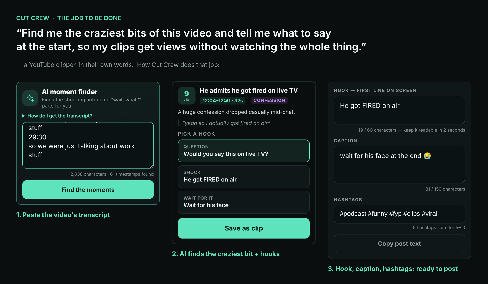

# The job to be done: Cut Crew

**Task (Week 5, Wed 7 Oct):** Learn what "the job to be done" means. Write your app's job in one sentence a customer would say.

## What "the job to be done" means
People don't want an app. They want something in their day to get done.
The job is that thing, said **in the customer's own words**: not what the app *is*, but what it *does for them*.

| ❌ What the app is | ✅ The job, in the customer's words |
|---|---|
| "An inventory app" | "Know what's in the store room without walking there" |
| "An AI clipping app" | "Find the bits of this video that'll go viral, so I don't have to watch all of it" |

## Who the customer is
A **YouTube clipper**: someone who takes long videos (podcasts, streams, interviews) and posts short clips on TikTok, Reels and Shorts to get views.

What their day looks like now:
- They watch a 1–3 hour video to find 30 seconds worth posting
- They guess at a hook and hope people don't scroll past
- It takes a long time, and most clips flop

## Cut Crew's job, in one sentence
> **"Find me the craziest bits of this video and tell me what to say at the start, so my clips get views without me watching the whole thing."**

Short version: **"Find the bits that'll go viral, so I don't have to watch the whole video."**

## How the app does that job (proof)

1. **Paste the video's transcript.** No watching the whole thing.
2. **The AI finds the craziest bit**, scores it out of 10, gives the exact time and quote, and writes 3 hook options. That's "tell me what to say at the start".
3. **The hook, caption and hashtags are ready to post** with one tap: "so my clips get views".

*The moment in the screenshot is an example result, used to show the screens.*

## How I'll check it's the right job
Ask clippers in the user tests: *"Is this what you're actually trying to do?"* If they say no, the sentence (and the app) changes.
